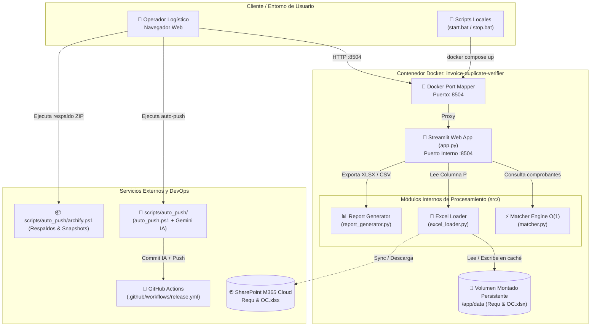

# Sistema de Verificación de Facturas Duplicadas (DAG)


**Invoice Duplicate Verifier** es una solución corporativa contenerizada desarrollada para **Díaz Acarreos (DAG)** para automatizar la consulta masiva, detección y validación de facturas y comprobantes electrónicos duplicados contra la **Columna P** del archivo Excel corporativo **`Requ & OC.xlsx`**.

El sistema integra un motor de búsqueda multicriterio con indexación en memoria $O(1)$ que procesa listas de comprobantes pegadas manualmente, evaluando coincidencias exactas (serie y número), números con ceros a la izquierda, números limpios sin ceros y alertas preventivas ante números coincidentes registrados bajo series distintas. Además, cuenta con una interfaz web en Streamlit optimizada sin elementos invasivos y herramientas DevOps de auto-commit con IA y versionado semántico en GitHub Actions.

---

## Tabla de Contenidos

1. [Diagrama de Arquitectura](#diagrama-de-arquitectura)
2. [Características Clave (Features)](#características-clave-features)
3. [Prerrequisitos y Entorno de Desarrollo](#prerrequisitos-y-entorno-de-desarrollo)
4. [Estructura del Repositorio](#estructura-del-repositorio)
5. [Herramientas de Automatización DevOps (scripts/auto_push)](#herramientas-de-automatización-devops-scriptsauto_push)
6. [Diagramas del Sistema (scripts/diagramas)](#diagramas-del-sistema-scriptsdiagramas)
7. [Instructivo de Despliegue con Docker](#instructivo-de-despliegue-con-docker)
8. [Instructivo de Uso Paso a Paso (Flujo de Trabajo)](#instructivo-de-uso-paso-a-paso-flujo-de-trabajo)
9. [Guía de Mantenimiento y Solución de Problemas](#guía-de-mantenimiento-y-solución-de-problemas)
10. [Licencia y Contacto](#licencia-y-contacto)

---

## Diagrama de Arquitectura



---

## Características Clave (Features)

- **Motor de Búsqueda Multicriterio Flexible:**
  - **1. Coincidencia Exacta:** Valida Serie y Número de manera idéntica (ej. `F85S-0000064535`).
  - **2. Por Correlativo con ceros:** Identifica registros donde el número conserva los ceros a la izquierda (ej. `0000064535`).
  - **3. Por Número sin ceros:** Detecta el correlativo sin importar la cantidad de ceros (ej. `64535` encuentra `0000064535`, `F85S-64535`, etc.).
  - **4. Alerta de Serie Cruzada (Preventiva):** Alerta al operador si el número correlativo ya existe en el Excel registrado bajo otra serie distinta (ej. `F001-0000064535` vs `F85S-0000064535`), evitando errores de digitación de operadores.
  - **5. Detección de Duplicados Internos:** Notifica si en la misma lista pegada por el usuario un comprobante se encuentra repetido.
- **Rendimiento Ultrarrápido $O(1)$:** Indexación en memoria mediante diccionarios Hash en [`src/matcher.py`](src/matcher.py), evaluando miles de registros en milisegundos sin bucles pesados.
- **Detección Automática de Columna P:** Localiza de forma predeterminada la 16ª columna (Columna P, índice 15) de `Requ & OC.xlsx`, permitiendo al usuario cambiarla mediante un selector si la estructura del archivo varía.
- **Interfaz Limpia y Corporativa:** Se han suprimido los botones de *Deploy*, decoración superior y el pie de página *Made with Streamlit*.
- **Reportes Profesionales Estilizados:** Generación automática de libros Excel (`.xlsx`) con formato condicional (verde para registros limpios, rojo/naranja para duplicados) y desglose en hojas de *Resumen*, *Detalle de Duplicados* y *No Encontrados*.
- **Herramientas de Automatización DevOps (`scripts/auto_push`):**
  - **`auto_push.ps1`:** Asistido por **IA (Google Gemini)** con fallback multi-modelo (`gemini-2.5-flash-lite`, `gemini-2.5-flash`) para analizar el diff de código, generar commits bajo el estándar **Conventional Commits** y sincronizar con GitHub.
  - **GitHub Actions SemVer:** Workflow integrado (`.github/workflows/release.yml`) que calcula automáticamente la versión semántica (`v1.0.1`, `v1.1.0`) y publica el Release oficial con changelog en cada push a `main`.
  - **`archify.ps1`:** Sistema de respaldo y empaquetado de reportes generados y snapshots limpios del proyecto con manifiesto JSON de trazabilidad.
- **Suite de Diagramas de Arquitectura (`scripts/diagramas`):**
  - Diagrama de arquitectura interactivo de alta fidelidad compilado con **Archify CLI** (`arquitectura.html` y `arquitectura.json`).
  - Visualizador interactivo de secuencias y protocolos en HTML/Mermaid con selector de tema oscuro/claro (`flujo_verificacion_facturas.html`).

---

## Prerrequisitos y Entorno de Desarrollo

Para ejecutar este proyecto en un entorno local o de producción, necesitas:
- **Docker Desktop v20+** (Asegurarse de tener habilitada la integración con WSL2 en Windows).
- **Docker Compose v2+**.
- **Git** (Para control de versiones y despliegues).
- *Nota:* No es indispensable tener Python ni Node.js instalados en el sistema anfitrión si utilizas Docker; el contenedor orquesta todo el entorno.

---

## Estructura del Repositorio

```text
L:\Streamlit\Invoice_Duplicate\
├── .github/
│   └── workflows/
│       └── release.yml          # Pipeline CI/CD: Semantic Versioning y GitHub Releases
├── .streamlit/
│   └── config.toml              # Configuración de tema, cliente y puerto 8504
├── archives/                    # Directorio de respaldos ZIP y snapshots generados
│   └── .gitkeep
├── data/
│   └── Requ & OC.xlsx           # Archivo Excel de Requerimientos y OCs (Columna P)
├── scripts/
│   ├── diagramas/
│   │   ├── arquitectura.json    # Especificación de arquitectura para Archify
│   │   ├── arquitectura.html    # Diagrama interactivo compilado con Archify CLI
│   │   ├── flujo_verificacion_facturas.html # Visualizador interactivo de secuencias
│   │   ├── secuencia_verificacion.mmd       # Diagrama de secuencia en Mermaid
│   │   ├── render_arquitectura.ps1          # Renderizador automatizado con Archify CLI
│   │   ├── render_arquitectura.bat          # Acceso directo para renderizado 1-clic
│   │   └── README.md            # Guía del módulo de diagramas
│   └── auto_push/
│       ├── api_keys.txt         # Llaves para la API de Gemini (IA Commit)
│       ├── auto_push.ps1        # Script PowerShell de auto-commit con IA y push
│       ├── auto_push.bat        # Acceso directo para ejecución con doble clic
│       ├── auto_push.py         # Versión alternativa en Python
│       ├── archify.ps1          # Empaquetador y respaldador estructurado (.zip)
│       ├── archify.bat          # Lanzador batch de Archify
│       └── README.md            # Documentación del módulo de automatización
├── src/
│   ├── __init__.py
│   ├── matcher.py               # Motor O(1) de indexación y coincidencia de facturas
│   ├── excel_loader.py          # Lector de Excel, detector de Columna P y conector SharePoint
│   └── report_generator.py      # Generador de reportes Excel estilizados con openpyxl
├── .dockerignore                # Exclusión de archivos en la construcción de imagen Docker
├── .gitignore                   # Exclusión estructurada de cachés, temporales y credenciales
├── app.py                       # Aplicación principal interactiva en Streamlit (:8504)
├── Dockerfile                   # Imagen base Python 3.11-slim optimizada
├── docker-compose.yml           # Orquestación con mapeo de puerto 8504 y volumen ./data
├── requirements.txt             # Dependencias del proyecto
├── start.bat                    # Script de inicio rápido en Windows (1-clic)
├── stop.bat                     # Script para detener el contenedor
└── README.md                    # Documentación técnica y manual de usuario
```

---

## Herramientas de Automatización DevOps (`scripts/auto_push`)

### 1. `auto_push` (Sincronización Git con IA)
Automatiza la inspección de cambios, redacción de commits y publicación en GitHub:
```powershell
# Ejecución asistida por IA (Gemini):
.\scripts\auto_push\auto_push.ps1

# Ejecución con mensaje personalizado:
.\scripts\auto_push\auto_push.ps1 -m "feat: optimizacion del parser de series SUNAT"

# Ejecución rápida en Windows (1-clic):
scripts\auto_push\auto_push.bat
```

### 2. `archify` (Respaldos y Snapshots)
Permite generar archivos `.zip` estructurados con manifiesto JSON de trazabilidad:
```powershell
# Snapshot completo del código fuente limpio:
.\scripts\auto_push\archify.ps1 -Mode Full -Tag "v1.0"

# Respaldo de reportes Excel generados:
.\scripts\auto_push\archify.ps1 -Mode Reports

# Simulación sin escritura (Dry-Run):
.\scripts\auto_push\archify.ps1 -Mode Full -DryRun

# Ejecución vía Batch:
scripts\auto_push\archify.bat Full
```

---

## Diagramas del Sistema (`scripts/diagramas`)

Para visualizar o compilar los diagramas:

- **Ver Arquitectura en Navegador:** Haz doble clic en [`scripts/diagramas/arquitectura.html`](scripts/diagramas/arquitectura.html).
- **Ver Diagrama de Secuencia:** Haz doble clic en [`scripts/diagramas/flujo_verificacion_facturas.html`](scripts/diagramas/flujo_verificacion_facturas.html).
- **Re-renderizar con Archify CLI:**
  ```powershell
  .\scripts\diagramas\render_arquitectura.ps1
  ```

---

## Instructivo de Despliegue con Docker

### 1. Clonado del Repositorio
```bash
git clone https://github.com/victorsvlynch/invoice_duplicate.git
cd invoice_duplicate
```

### 2. Archivo Excel de Datos
Coloca el archivo `Requ & OC.xlsx` dentro de la carpeta `data/` o súbelo directamente a través de la interfaz web una vez levantada la aplicación.

### 3. Despliegue Containerizado
Ejecuta en la terminal de la raíz del proyecto:
```bash
docker compose up --build -d
```
*(En Windows también puedes hacer doble clic en el archivo [`start.bat`](start.bat)).*

### 4. Persistencia de Datos
El archivo [`docker-compose.yml`](docker-compose.yml) declara un volumen montado (`./data:/app/data`). Todo archivo colocado en la carpeta local `data/` estará disponible de inmediato dentro del contenedor sin necesidad de reconstruir la imagen.

---

## Instructivo de Uso Paso a Paso (Flujo de Trabajo)

### Acceso a la Plataforma
Abre tu navegador en:
👉 **[http://localhost:8504](http://localhost:8504)**

### Ejemplo Práctico de Uso
1. **Cargar o Verificar Excel:**
   - En la barra lateral izquierda, verifica que el archivo `Requ & OC.xlsx` esté cargado y que la columna seleccionada sea la **Columna P** (por defecto).
2. **Pegar Comprobantes:**
   - En el cuadro de texto central, pega tu lista de comprobantes (un comprobante por línea).
   - Puedes hacer clic en **"📋 Cargar Ejemplo de Prueba"** para cargar automáticamente una muestra de 23 comprobantes de prueba.
3. **Ejecutar Verificación:**
   - Haz clic en **"🔍 Verificar Duplicados en Excel"**.
4. **Analizar Resultados:**
   - **Métricas:** Revisa el total de comprobantes consultados, duplicados encontrados y comprobantes nuevos/limpios.
   - **Pestaña Resumen General:** Tabla con estado por fila y filtros rápidos.
   - **Pestaña Detalle de Coincidencias:** Muestra la fila exacta de Excel donde se encontró el comprobante, el tipo de coincidencia y los datos de esa fila.
   - **Pestaña Solo No Encontrados:** Lista limpia de facturas nuevas listas para ser copiadas al portapapeles.
5. **Descargar Reportes:**
   - Descarga el reporte completo en Excel (`.xlsx`) o CSV mediante los botones de exportación.

---

## Guía de Mantenimiento y Solución de Problemas

| Tarea / Comando | Descripción |
| :--- | :--- |
| `docker compose logs -f` | Monitorear en tiempo real los registros de la aplicación. |
| `docker compose up --build -d` | Reconstruir la imagen y reiniciar el contenedor. |
| `docker compose restart` | Reiniciar el servicio sin reconstruir la imagen. |
| `docker compose down` | Detener el contenedor de la aplicación. |
| `docker compose down -v` | Detener el contenedor y limpiar volúmenes temporales. |

---

## Licencia y Contacto
**Desarrollado para:** Transportes y Logística DAG (Díaz Acarreos)  
**Autor:** Victor Lynch - victorsvlynch@gmail.com  
**Licencia:** Propietaria. Reservados todos los derechos para el ecosistema corporativo DAG.
